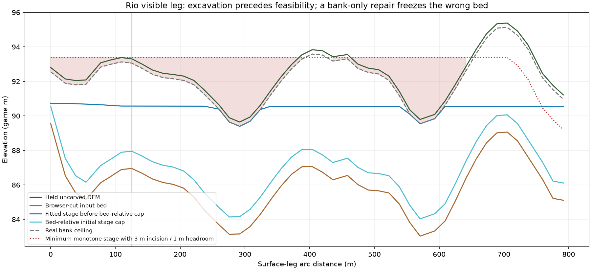

## Coupled Rio investigation — rejected arm, original fallback

The one coupled arm is rejected at the CPU gate. Default production generation and all five candidate packages remain the original stream-only 690d2b1 bytes. This is partial delivery: Asheville improves; Rio's opening scar is unresolved. Neither this arm nor the previous 24 m/bank-restoration arms should ship.

### First unsupported operation

The browser burns a nominal 10 m channel (9.1988 game metres after terrain fitting) before hydrology asks whether a feasible visible water profile exists. At Rio world (-1200,3632), held uncarved DEM is 93.309890747 m, the exact browser PNG bed is 86.954451820 m, prepared bed is 86.953125 m, and the original source target is 87.953125 m. Hydrology can lower but not restore that inherited browser excavation; the bank-limited supply is subsequently capped at prepared bed + 1 m.

The visible Maracanã connector is 791.7645 m long / 48 routed vertices, not an existing short-under-45 case. Both ends connect to explicit underground source geometry. Its wanted profile near the control is 90.496256 m; fitted profile 90.569687 m; real bank ceiling 93.059891 m. The original profile exceeds some bank ceilings by 1.165275 m. Against the held uncarved DEM, a monotone profile with the existing 3 m incision bound and 1 m headroom exceeds a bank ceiling by 3.988426 m in the routed direction, or 2.415672 m even in reverse. This is a contradiction within these DEM/model bounds, not proof that the natural waterway cannot flow.

The rerunnable trace records source visibility, tunnel endpoints, complete profile arrays and the actual native four-vertex interpolation stencil. At the control / previous elbow-bank observation, CPU native-stencil ground is uncarved [93.3125,92.1875], browser [86.953125,86.984375], hydrology/prepared [86.953125,86.9375] m. The first wrong stage is therefore admission of browser excavation before supported stage/profile—not merely a bank postprocess.

### One coupled counterfactual

Experimental source 2182494683fbe0505939c0bbe4ae23d4418208b7 defers the browser line burn and artificial source/drain forcing only on finite surface connectors with actual shared tunnel endpoints AND the bounded gravity contradiction. It uses the production browser carver, unchanged 40 m half-width, and retains polygon/lake contributions and tunnel visibility policy. It does not classify on a river label, missing polygon or named observation. Source reanchoring/initial water are coupled changes, not a terrain-only contrast.

The experiment fails its controls: 16 source pieces deferred, 12 hydrology reaches unforced, controls 290→244, starting tile 21→22, 112 horizontal network nodes moved. At the control, bed rises only to 91.796875 m because polygon incision remains, with just 0.25 m initial water. This is neither fully uncarved nor a demonstrated visibly wet channel. Terrain changes in 10,466 cells (1,938 lower); initial water changes in 1,845. Candidate SHA c7a5a17b81891f8f1afb04cb5aa1a1df0725d6e365612aab8b5baf7af8ac8c26 is quarantined and was NOT launched natively or passed through shipping-JS parity. No second Rio variant was attempted.

The next defensible correction must decide whether a source-visible connector has a supported profile BEFORE both line and polygon excavation are admitted, and preserve starting-tile/network placement explicitly. It must not pump the existing trench, treat tunnel connectivity alone as an exemption, or rely on the observed water footprint. The held DEM contradiction needs resolving before a visibly wet bounded-incision solution can be claimed.

### Reproduction and controls

Run `uv run --project tools/map-factory python tools/map-factory/trace_coupled.py INPUTS/rio OUT.json`. The rejected builder fails closed on the current default; replay its exact historical experimental head if needed. `fixtures/coupled-rejected/` retains causal arrays, package receipt and CPU rejection. Current default `region.py` is restored byte-for-byte; accepted fixture history, failure subsets, probes, masks, thresholds, PL926 policy and networks are not rewritten.

Fresh regeneration of all five default packages matches the archived stream-only candidate identities. Fresh Python/shipping-JS/Pyodide agreement includes complete CRPs, terrain and water grids. 44 writer tests pass (2 skips); 113 harness tests pass; installed-game build/doctor and scoped lint/format pass. The short coupled arm is a rejected experiment, not a product fix.

### Qualification probe preservation

The first native cohort exposed inherited terrain-route probe drift versus the accepted PL926 record: 74 Asheville positions, 16 Innsbruck positions including one omitted legacy name, 6 Rio positions and 21 Pittsburgh positions; Charleston is unchanged. Required flags were not changed. These preliminary captures are retained, not presented as exact legacy-probe qualification. Candidate staging now reads the hash-bound accepted hydrology fixture samples instead of candidate routes. An actual five-map staging check reproduces every original point, name, coordinate, flag and order, with CRPs and mapped-water masks unchanged; see `fixtures/minor-stream-candidate/probe-freeze.json`. Final qualification repeats the affected maps using that frozen set; eleven extra Rio diagnostic observations remain supplementary and do not replace any original point.

The plotted bank ceiling is the existing model ceiling derived from held uncarved DEM minus 0.25 m, not an independently surveyed bank elevation. Native water/velocity observations remain separate from this CPU profile.

The expanded coverage audit also found prepared-input staging omitted Asheville’s accepted independent summit landmarks, and the new hold-opening mode skipped the legacy camera-state check. Both are repaired: accepted landmark coordinates/heights/tolerances and ground-truth definitions remain exact; hold mode reads the original native camera state and applies the unchanged heading gate without camera mutation. The final complete native cohort retains these gates. A CPU regression checks that north still passes and south still fails in hold mode.

The profile contradiction does not determine whether an alternative geometry-supported raster path avoids the crest or the held DEM needs channel conditioning. Those remain competing follow-up hypotheses; neither justifies a guessed width, arbitrary head increase, or another bank-only repair.
